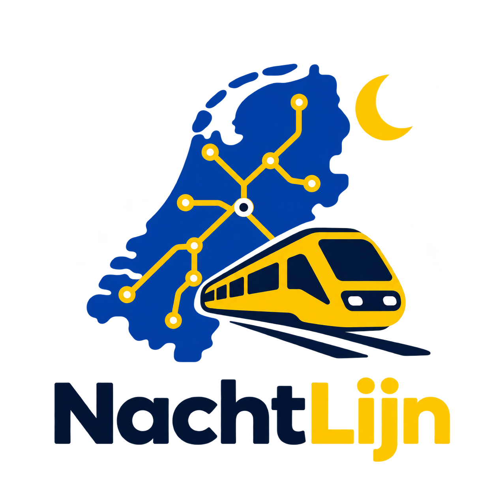
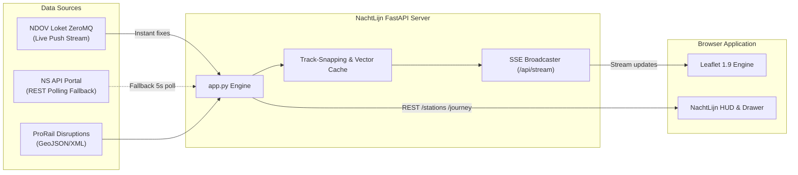

# 🚆 NachtLijn (Live Spoorradar & Treinvolger)

<p align="center">
  
</p>

<p align="center">
  <strong>Real-time Dutch railway radar powered by high-frequency push streams, track-snapping physics, and authentic NS styling.</strong>
</p>

<p align="center">
  
  
  
  
</p>

---

## ✨ Features

- **⚡ Hybrid Real-Time Ingestion (Push + Polling)**:
  - Subscribes directly to the open NDOV / GOVI ZeroMQ push feed (`/RIG/NStreinpositiesInterface5` at `tcp://pubsub.besteffort.ndovloket.nl:7664`).
  - Seamless fallback to the official NS API endpoint when push streams are inactive or during maintenance.
  - Pushes updates instantly to web clients via Server-Sent Events (SSE).

- **📐 Along-Track Animation & Dead Reckoning**:
  - Eliminates train drifting and "rubber-banding" by projecting raw GPS coordinates onto high-precision railway vectors.
  - Interpolates smooth 60fps movement along track curvature and clamps advancement as trains approach station dwell points.

- **🎨 Authentic NS Brand Design**:
  - Engineered with official Nederlandse Spoorwegen color tokens:
    - **NS Resolution Blue**: `#003082`
    - **NS Lightning Yellow**: `#FFC917`
    - **Rolling Stock Light Gray**: `#E0E0DE`
    - **Sprinter Blue**: `#00AEEF`
  - High-contrast HUD with live train count badges (IC, Sprinter, International).
  - Prominent Dutch national border glow rendered on Carto Dark Matter basemap.

- **🗺️ Interactive Map Layers**:
  - **Basemaps**: CARTO Dark Matter (default), PDOK Grijs, PDOK Standaard, and PDOK Luchtfoto (official high-res aerial imagery).
  - **Interactive Station Dots**: Zoom-dependent markers with live digital departure boards and platform tracking.
  - **Rail Disruptions & Maintenance**: Real-time ProRail incidents categorized with severity indicators.

- **📋 Journey Timeline & Next-Stop Intelligence**:
  - Slide-out journey drawer showing timetable, rolling stock composition, and active destination.
  - Automatically suppresses non-stopping pass-through stations to keep timetables clear and actionable.
  - Real-time pulse indicator on the train's imminent upcoming station.

---

## 🛠️ Architecture



---

## 🚀 Quickstart

### Prerequisites
- Python 3.11+
- (Optional) Free API key from the [NS API Portal](https://apiportal.ns.nl) for timetable journey drill-downs.

### 1. Clone & Set Up Environment

```bash
git clone git@github.com:ml3m/NachtLijn.git
cd NachtLijn

# Copy environment template
cp .env.example .env
# Edit .env and paste your NS_API_KEY (optional, fallback data works without it)
```

### 2. Run with Python Virtual Environment

```bash
python3 -m venv .venv
source .venv/bin/activate
pip install -r requirements.txt

# Start server
uvicorn app:app --host 0.0.0.0 --port 8080 --reload
```

Open [http://localhost:8080](http://localhost:8080) in your browser.

---

## 🐳 Docker Deployment

### Using Docker Compose (Recommended)

```bash
docker compose up -d --build
```

### Using Standard Docker CLI

```bash
# Build image
docker build -t nachtlijn:latest .

# Run container
docker run -d \
  --name nachtlijn \
  -p 8080:8080 \
  -e NS_API_KEY="your_api_key_here" \
  --restart unless-stopped \
  nachtlijn:latest
```

Check container status and health:
```bash
docker ps
curl http://localhost:8080/api/health
```

---

## 📡 API Endpoints

| Endpoint | Method | Description |
|---|---|---|
| `/api/health` | `GET` | Service health status, tracked train count, and active feed mode |
| `/api/stream` | `GET` | Server-Sent Events (SSE) live push stream of train locations |
| `/api/trains` | `GET` | Snapshot of all currently active trains in the network |
| `/api/stations` | `GET` | GeoJSON dataset of Dutch railway stations with codes and platforms |
| `/api/border` | `GET` | GeoJSON boundary of the Netherlands for prominent border rendering |
| `/api/disruptions` | `GET` | Active rail disruptions and scheduled maintenance |
| `/api/journey/{id}` | `GET` | Timetable, intermediate stops, and rolling stock info for a train |
| `/api/departures/{code}` | `GET` | Live departure board for a given station code (e.g. `ASD`, `UT`) |

---

## 🔒 Security & Privacy

- No API credentials or private keys are bundled with this repository.
- Sensitive environment configurations are excluded via `.gitignore`.
- Container runs as a non-privileged user (`appuser`, UID 1000).

---

## 📜 Credits & Acknowledgements

- **Train Positions**: [NDOV Loket / GOVI](https://govi.nu/) & [NS API Portal](https://apiportal.ns.nl/)
- **Disruptions & Timetables**: [NS InfoPlus](https://data.ndovloket.nl/)
- **Railway Infrastructure**: [OpenStreetMap Contributors](https://osm.org)
- **Map Tiles**: [CARTO](https://carto.com/) & [PDOK Kadaster](https://www.pdok.nl/)
>>>>>>> fac8d97 (feat: NachtLijn live rail radar with ZeroMQ push stream, along-track engine, and NS branding)
